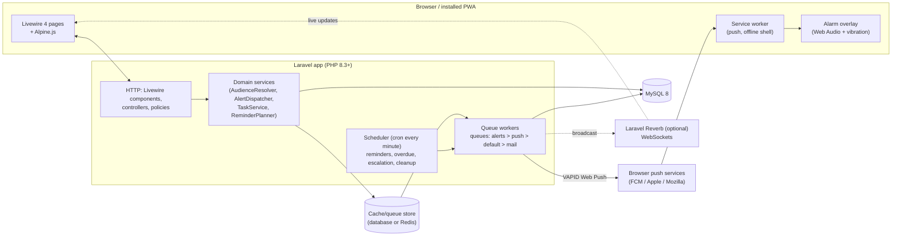
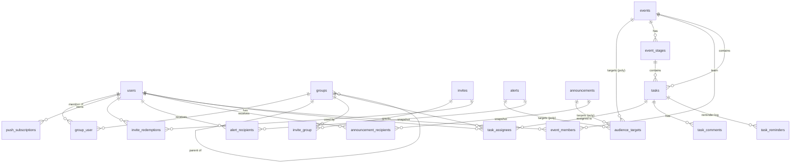

# MCI — Mechaniczne Centrum Informacyjne

**Architecture, data model, permission model and roadmap (v0.2)**

Status: Steps 0 and 1 implemented. Decisions taken with the school are recorded in §10; the target hosting is **shared PHP hosting** (§2.2).

---

## 1. Goals and guiding principles

| Problem today | MCI answer |
|---|---|
| One shared feed/calendar for everyone, lots of noise | Every message, alert and event has an explicit **audience** (groups ∪ users). Users only see what targets them. |
| Urgent safety information can be missed | **Safety alerts** with a priority queue, Web Push, full-screen in-app alarm and **mandatory "Potwierdzam odbiór"** with live tracking. |
| Multi-step school events are run in chats and spreadsheets | **Event → Stage → Task** with deadlines, leads, teams, reminders and overdue alerts, plus personal To-Do. |

Principles:

1. **Audience snapshot at send time.** When something is sent, the union of targeted groups/users is resolved once and written to a per-recipient table. This makes delivery/ack statistics honest ("who *should* have acknowledged") and keeps reads fast.
2. **Environment-driven infrastructure.** Queue driver, broadcasting/real-time mode, mail, VAPID keys, cache — all `.env`. The same code runs on shared PHP hosting (cron only) and on a VPS (Supervisor, Redis, WebSockets).
3. **Progressive real-time.** Real-time is a nice-to-have upgrade, never a dependency. Baseline is Livewire polling; WebSockets (Laravel Reverb) switch on when hosting allows.
4. **Polish-facing UI, English code.** Code, DB and identifiers in English; all UI strings through `lang/pl/*.php` (`APP_LOCALE=pl`, `APP_TIMEZONE=Europe/Warsaw`), so an English UI is free later.
5. **Small, boring dependencies.** Prefer first-party Laravel packages and a few well-maintained community ones.

---

## 2. System architecture



### 2.1 Tech choices

| Concern | Choice | Notes |
|---|---|---|
| Framework | Laravel 13, PHP 8.3+ | Plain skeleton + Fortify (the official starter kit lagged behind Laravel 13 / Livewire 4 at the time). |
| UI | Livewire 4 (+ Alpine.js bundled), Tailwind CSS v4, Vite | Class-based Livewire page components (`app/Livewire`), Blade components for UI primitives. System font stack (no font CDN). |
| UI kit | **Flux UI (free tier)** for inputs, modals, dropdowns, tables; own Blade components for domain widgets | Flux is the official Livewire kit and plays well with `wire:model`. If you prefer zero vendor UI, the same layout works with plain Blade components (see §8). |
| Auth | Laravel Fortify: e-mail + password login, password reset / account set-up links, no public registration | 2FA for privileged roles planned in Step 9. |
| RBAC | `spatie/laravel-permission` for global roles & permissions | Group/event-scoped leadership is modelled in our own pivots (§4). |
| Web Push | `laravel-notification-channels/webpush` (uses `minishlink/web-push`) | VAPID keys in `.env`. Push subscriptions table from the package. |
| Queues | `QUEUE_CONNECTION=database` by default, `redis` on VPS | Named queues: `alerts`, `push`, `default`, `mail`. |
| Real-time | `BROADCAST_CONNECTION=null` + `wire:poll` (baseline) or `reverb` (VPS) | Alert ack board polls every 3 s in baseline mode; pushes instantly with Reverb. |
| QR codes | `simplesoftwareio/simple-qrcode` (or `bacon/bacon-qr-code`) | For invite links, printable PDF/PNG. |
| Audit | own `audit_logs` table (`App\Support\Audit::log()`) | Accounts, access, groups, settings now; alerts later. |
| Tests / quality | Pest, Laravel Pint, GitHub Actions CI on SQLite **and MySQL 8** | Larastan can be added later. |

### 2.2 Deployment profiles

**Decision: the school uses shared PHP hosting (Profile A).** Everything must work with PHP + MySQL + one cron entry. Profile B stays possible by changing `.env` only. Step-by-step instructions: [`DEPLOYMENT.md`](DEPLOYMENT.md).

| | **Profile A — shared hosting (default, target)** | **Profile B — VPS (optional later)** |
|---|---|---|
| Cron | `* * * * * php artisan schedule:run` | same |
| Queue | `QUEUE_CONNECTION=database`, `MCI_QUEUE_VIA_SCHEDULER=true`: the scheduler starts `queue:work --stop-when-empty --max-time=50 --queue=alerts,push,default,mail` every minute (`routes/console.php`). Fallback: a second cron line running the same command if the host forbids process spawning. | `redis`; Supervisor keeps `queue:work` running, `MCI_QUEUE_VIA_SCHEDULER=false` |
| Real-time | `MCI_REALTIME=poll`: Livewire `wire:poll` every `MCI_POLL_SECONDS` (5 s default; 3 s on the alert ack board) | `MCI_REALTIME=broadcast` + Laravel Reverb |
| Cache / session | `database` / `database` | `redis` |
| Alert latency | Queue work starts within ~60 s, so **alerts never wait for cron**: the first push batch is dispatched after the HTTP response (`dispatch()->afterResponse()`), remaining batches and escalations go through the queue. Open apps also poll for active alerts. | seconds |

Every UI feature that would use WebSockets must have a polling path; this is a hard rule for Steps 3–8.

### 2.3 Application layout

```
app/
  Domain/
    Audience/        AudienceResolver, AudienceTarget value objects
    Alerts/          AlertDispatcher, Actions/SendAlert, Actions/AcknowledgeAlert
    Announcements/   Actions/PublishAnnouncement
    Events/          Actions/CreateEvent, StageService
    Tasks/           TaskService, ReminderPlanner
    Invites/         InviteService (redeem, QR generation)
  Models/            Eloquent models (thin; relationships, casts, scopes)
  Policies/          one policy per aggregate (Alert, Event, Task, Group, Invite…)
  Jobs/              SendAlertPushBatch, SendTaskReminder, MarkOverdueTasks, EscalateUnacknowledgedAlert…
  Notifications/     AlertRaised, TaskAssigned, TaskDueSoon, TaskOverdue, AnnouncementPublished
  Events/ Listeners/ AlertAcknowledged (broadcast), TaskCompleted…
  Enums/             AlertSeverity, TaskStatus, GroupRole, EventRole, Permission…
resources/views/
  components/ui/     own primitives (card, badge, stat, empty-state, page-header)
  components/app/    domain widgets (alert-banner, ack-progress, task-row, audience-picker)
  layouts/           app.blade.php (sidebar + topbar + bottom nav on mobile), guest.blade.php
  livewire/          pages grouped by module: dashboard/, alerts/, events/, tasks/, groups/, admin/
lang/pl/             all UI strings
public/              manifest.webmanifest, sw.js, icons/, sounds/alarm.mp3
```

Business logic lives in `Domain/*` action classes so Livewire components stay thin and logic is testable without the UI.

---

## 3. Database schema (MySQL 8, InnoDB, utf8mb4)

Conventions: `id` BIGINT UNSIGNED PK, `created_at/updated_at`, soft deletes where stated, all FKs indexed, enums stored as `VARCHAR` backed by PHP enums (easier migrations than MySQL `ENUM`).

### 3.1 Entity–relationship overview



### 3.2 Identity, roles, groups

**`users`**
| column | type | notes |
|---|---|---|
| id | bigint PK | |
| first_name, last_name | varchar(100) | |
| email | varchar(191) unique | login |
| phone | varchar(32) null | future SMS fallback |
| password | varchar null | null until invite redeemed / set |
| status | varchar(20) | `invited`, `active`, `suspended` — index |
| last_seen_at | timestamp null | |
| locale | varchar(5) default `pl` | |
| notification_prefs | json null | quiet hours, email digest on/off (alerts ignore quiet hours) |
| two_factor_* | (Fortify columns) | |
| email_verified_at, remember_token, timestamps, deleted_at | | soft delete |

**Spatie tables** — `roles`, `permissions`, `model_has_roles`, `model_has_permissions`, `role_has_permissions` (standard, `guard_name=web`).

**`groups`**
| column | type | notes |
|---|---|---|
| id | bigint PK | |
| parent_id | FK groups null | optional hierarchy (e.g. *Nauczyciele zawodowi* under *Nauczyciele*). Targeting a parent does **not** auto-include children unless `include_subgroups` is chosen on the target (§3.4). |
| name | varchar(150) | |
| slug | varchar(150) unique | |
| type | varchar(30) | `staff`, `subject`, `vocational`, `class_tutors`, `class`, `volunteering`, `sport`, `custom` — index |
| description | text null | |
| color | varchar(7) null | UI chip colour |
| is_system | bool | e.g. *Wszyscy pracownicy* — cannot be deleted |
| membership_mode | varchar(20) | `managed` (only leaders/admins add), `invite` (QR/invite), `open` (self-join) |
| created_by | FK users | |
| timestamps, deleted_at | | |

**`group_user`** (pivot)
| column | type | notes |
|---|---|---|
| group_id | FK | PK (group_id, user_id) |
| user_id | FK | index |
| role | varchar(20) | `member`, `leader` (GroupRole enum) |
| joined_via | varchar(20) | `admin`, `invite`, `self` |
| invite_id | FK invites null | |
| timestamps | | |

**`invites`** (QR / token onboarding)
| column | type | notes |
|---|---|---|
| id | bigint PK | |
| token | char(40) unique | random, URL-safe; QR encodes `https://app/join/{token}` |
| kind | varchar(20) | `personal` (bound to one email/user, single use), `group_link` (multi-use poster QR) |
| email | varchar(191) null | for personal invites |
| user_id | FK users null | pre-provisioned account the invite activates |
| role_name | varchar(50) null | global role granted on redeem (e.g. `teacher`); only roles the creator may grant |
| max_uses | int null | null = unlimited |
| uses_count | int default 0 | |
| expires_at | timestamp null | index |
| revoked_at | timestamp null | |
| created_by | FK users | |
| timestamps | | |

**`invite_group`** — `invite_id`, `group_id`, `group_role` (`member`/`leader`). One invite can add the user to several groups at once.

**`invite_redemptions`** — `id`, `invite_id`, `user_id`, `redeemed_at`, `ip`, `user_agent`. Audit + limit enforcement.

**`push_subscriptions`** (from webpush package) — `subscribable_type/id`, `endpoint` (unique, 500), `public_key`, `auth_token`, `content_encoding`, plus our extras: `device_label`, `platform` (`ios`, `android`, `desktop`), `last_success_at`, `failed_at`. Dead endpoints (HTTP 404/410) are deleted automatically.

### 3.3 Audience targeting (shared by alerts, announcements, events)

**`audience_targets`** (polymorphic owner, polymorphic target)
| column | type | notes |
|---|---|---|
| id | bigint PK | |
| owner_type, owner_id | morph | `alert`, `announcement`, `event` — index |
| target_type | varchar(20) | `group`, `user`, `role`, `everyone` |
| target_id | bigint null | group/user/role id; null for `everyone` |
| include_subgroups | bool default false | for group targets |

`AudienceResolver::resolve($owner)` returns the **deduplicated union** of active users from all targets (and optionally excludes the sender). Resolution is a single SQL `UNION` query; the result is bulk-inserted into the owner's `*_recipients` table in chunks of 1 000.

### 3.4 Announcements (targeted information feed)

**`announcements`** — `id`, `author_id` FK, `title`, `body` (markdown, sanitized), `priority` (`normal`, `important`), `requires_read_confirmation` bool, `published_at` null (scheduled publish), `expires_at` null, `pinned_until` null, timestamps, deleted_at. Index `(published_at, expires_at)`.

**`announcement_recipients`** — `announcement_id`, `user_id` (PK pair), `notified_at`, `read_at`, `confirmed_at`. Index `(user_id, read_at)` for the "unread" badge.

**`attachments`** (polymorphic, reused by announcements/tasks/events) — `attachable_type/id`, `disk`, `path`, `original_name`, `mime`, `size`, `uploaded_by`.

### 3.5 Safety alerts

**`alert_templates`** — `id`, `name`, `severity`, `title`, `body`, `default_targets` json, `sound` varchar, `is_active`. Pre-defined e.g. *Ewakuacja*, *Zagrożenie – zostań w sali (lockdown)*, *Pożar*, *Odwołanie alarmu*. Lets an authorised user fire an alert in two taps.

**`alerts`**
| column | type | notes |
|---|---|---|
| id | bigint PK | |
| uuid | char(36) unique | used in push payloads / URLs |
| template_id | FK null | |
| sender_id | FK users | |
| severity | varchar(20) | `info`, `warning`, `critical` |
| title | varchar(150) | |
| body | text | |
| requires_ack | bool default true | |
| status | varchar(20) | `dispatching`, `active`, `resolved`, `cancelled` — index |
| is_drill | bool default false | *Ćwiczenia* — same flow, separate stats, clear label |
| ack_deadline_minutes | smallint null | triggers escalation (re-push) to non-acknowledged |
| recipients_count | int | denormalized for fast stats |
| acknowledged_count | int | incremented atomically on ack |
| sent_at, resolved_at | timestamp null | |
| resolved_by | FK users null | |
| parent_alert_id | FK alerts null | follow-up / "all clear" linked to original |
| timestamps | | (no soft delete — alerts are an audit record) |

**`alert_recipients`** (the per-recipient tracking the sender watches live)
| column | type | notes |
|---|---|---|
| id | bigint PK | |
| alert_id | FK | |
| user_id | FK | unique (alert_id, user_id) |
| push_status | varchar(20) | `pending`, `sent`, `failed`, `no_subscription` |
| push_sent_at | timestamp null | when push service accepted the message |
| delivered_at | timestamp null | service worker reported receipt (best-effort, see §6) |
| opened_at | timestamp null | alert screen opened |
| acknowledged_at | timestamp null | "Potwierdzam odbiór" |
| ack_device | varchar(20) null | `pwa`, `browser`, `email_link` |
| ack_note | varchar(255) null | optional: "Jestem z klasą 2B w sali 14, wszyscy bezpieczni" |
| reminder_count | tinyint default 0 | escalation re-pushes |

Indexes: `(alert_id, acknowledged_at)` for the live board, `(user_id, acknowledged_at)` for "my pending alerts".

### 3.6 Events, stages, tasks, To-Do

**`events`** (multi-stage undertakings, e.g. *Dzień Otwarty*, *Zawody sportowe*, *Akcja charytatywna*)
| column | type | notes |
|---|---|---|
| id | bigint PK | |
| title, description | | |
| status | varchar(20) | `draft`, `planned`, `in_progress`, `completed`, `cancelled` — index |
| starts_at, ends_at | datetime null | appear in recipients' calendar |
| location | varchar(150) null | |
| owner_id | FK users | creator |
| lead_user_id | FK users null | responsible person |
| lead_group_id | FK groups null | responsible team (e.g. *Wolontariat*) |
| visibility | varchar(20) | `team` (members only), `audience` (team + audience_targets see it in calendar), `everyone` |
| timestamps, deleted_at | | |

**`event_members`** — `event_id`, `user_id`, `role` (`lead`, `coordinator`, `member`, `viewer`). Event-scoped permissions (§4.3). Members of `lead_group_id` are implicitly `member`.

**`event_stages`** — `id`, `event_id` FK, `title`, `description`, `position` smallint, `starts_at` null, `due_date` datetime null, `lead_user_id` null, `lead_group_id` null, `status` (`pending`, `in_progress`, `done`), `completed_at`. Index `(event_id, position)`.

**`tasks`** (one table for personal To-Do and project tasks)
| column | type | notes |
|---|---|---|
| id | bigint PK | |
| event_id | FK null | null = standalone/personal task |
| stage_id | FK null | must belong to event_id (validated in app) |
| parent_id | FK tasks null | optional subtasks/checklist |
| created_by | FK users | |
| title | varchar(200) | |
| description | text null | |
| is_personal | bool | personal To-Do visible only to creator |
| priority | tinyint | 1 low … 4 urgent |
| status | varchar(20) | `todo`, `in_progress`, `blocked`, `done`, `cancelled` |
| due_date | datetime null | |
| remind_before_minutes | int null | custom reminder; default from settings |
| completed_at, completed_by | null | |
| position | int | ordering inside a stage / list |
| timestamps, deleted_at | | |

Indexes: `(status, due_date)` for overdue scans, `(event_id, stage_id, position)`, `(created_by, is_personal)`.

**`task_assignees`** — `id`, `task_id`, `user_id` null, `group_id` null (exactly one set; CHECK constraint), `assigned_by`, `assigned_at`. A group assignment means "any member of the team"; the dashboard shows it to all members, and completion by one member completes it (option for per-member completion later).

**`task_comments`** — `id`, `task_id`, `user_id`, `body`, timestamps.

**`task_reminders`** (idempotency log so the scheduler never sends twice) — `id`, `task_id`, `user_id`, `type` (`due_soon`, `due_today`, `overdue`, `overdue_daily`), `sent_at`. Unique `(task_id, user_id, type, DATE(sent_at))` via a `sent_on` date column.

### 3.7 Cross-cutting

- **`notifications`** — Laravel's database notifications table (in-app bell / notification centre for everything that is not an alert).
- **`audit_logs`** — `actor_id`, `action`, `subject_type/id`, `properties` json, `ip`, `created_at`. Logged: alert sent/resolved, role/permission changes, invite created/revoked, group membership changes by admins.
- **`settings`** — key/value json for school-wide settings (school name, default reminder offsets, alert escalation defaults, quiet hours).
- Laravel defaults: `jobs`, `job_batches`, `failed_jobs`, `cache`, `sessions`, `password_reset_tokens`.

---

## 4. Permission & group model

Three layers, checked together in Laravel **Policies**:

1. **Global role → permissions** (Spatie). *What kind of user are you?*
2. **Group role** (`group_user.role` = `leader`/`member`). *Which teams do you lead?*
3. **Event role** (`event_members.role`). *What is your part in this event?*

### 4.1 Global roles (seeded, editable by admin)

| Role (PL label) | Intended for |
|---|---|
| `admin` (*Administrator*) | IT / school management — everything |
| `coordinator` (*Koordynator*) | vice-principal, safety officer, event coordinators |
| `teacher` (*Nauczyciel*) | all teaching staff |
| `staff` (*Pracownik*) | administration, support staff |
| `student` (*Uczeń*) | **later** — schema-ready, no permissions in MVP |

### 4.2 Permissions (seeded)

| Permission | admin | coordinator | teacher | staff |
|---|:-:|:-:|:-:|:-:|
| `users.manage` (create, suspend, assign roles) | ✓ | | | |
| `groups.manage` (any group) | ✓ | ✓ | | |
| `invites.create` | ✓ | ✓ | | |
| `announcements.publish.any` (any audience) | ✓ | ✓ | | |
| `announcements.publish.own_groups` | ✓ | ✓ | ✓ | |
| `alerts.send` | ✓ | * | | |
| `alerts.send.drill` | ✓ | ✓ | | |
| `alerts.view_all_stats` | ✓ | ✓ | | |
| `events.create` | ✓ | ✓ | ✓ | |
| `tasks.assign.any` | ✓ | ✓ | | |
| `stats.view` | ✓ | ✓ | | |
| `roles.manage` (grant roles / individual permissions) | ✓ | | | |
| `audit.view` | ✓ | ✓ | | |
| `settings.manage` (incl. appearance) | ✓ | | | |

\* **Decision:** `alerts.send` is not part of any role except admin. It is granted **directly to individual users** (Spatie direct permissions) by someone with `roles.manage`, e.g. the safety officer or reception. The admin user form has an "Uprawnienia indywidualne" panel for this. Coordinators get only `alerts.send.drill` by default.

Students (`student` role) exist in the schema but have no permissions and are optional in phase one; student accounts can be imported or created later without schema changes. Group type `class` is ready for school classes.

The matrix is seeded from `App\Enums\Role::defaultPermissions()`. The seeder is idempotent and does not overwrite later changes an admin made to a role.

\* `alerts.send` can also be granted **directly to an individual user** (Spatie direct permissions), e.g. the school safety inspector, without making them a coordinator. That matches "triggerable only by users with explicit permission".

### 4.3 Scoped rules (Policies)

- **Group leader** may: add/remove members of *their* group, create invites for *their* group, publish announcements to *their* group, assign tasks to *their* group or its members.
- **Event lead / coordinator** (`event_members.role in [lead, coordinator]` or `events.lead_user_id`, or leader of `events.lead_group_id`) may: edit the event, manage stages, create tasks inside it and assign them to event members or the lead group.
- **Event member** may: see the event, update status of tasks assigned to them or their group, comment.
- **Everyone** may: create personal To-Do (`is_personal = true`, visible only to them), see items they are a recipient/assignee of, acknowledge alerts.
- **Assigning a task to someone else** requires one of: `tasks.assign.any`; being event lead/coordinator (inside that event); being leader of the target group (for group or member assignment).
- **Invites can never grant more than the creator has**: a group leader's invite may only add to groups they lead and may not set a global role; only `users.manage` may set `role_name = coordinator/admin`.

Policy example (sketch):

```php
// TaskPolicy
public function assign(User $user, Task $task, User|Group $assignee): bool
{
    if ($user->can('tasks.assign.any')) return true;
    if ($task->event && $user->leadsEvent($task->event)) return $task->event->hasParticipant($assignee);
    return $assignee instanceof Group
        ? $user->leadsGroup($assignee)
        : $user->leadsAnyGroupContaining($assignee);
}
```

Group/event leadership lookups are cached per request (`$user->ledGroupIds()` memoized) to avoid N+1 policy queries.

---

## 5. Key flows

### 5.1 Onboarding

1. **Central provisioning** — admin imports a CSV (first name, last name, email, groups, role) or adds users manually → accounts `status=invited` + personal invite e-mail with a set-password link.
2. **QR / invite link** — coordinator or group leader creates an invite (one or several groups, optional role, expiry, max uses) → app shows a QR code (printable poster/PDF) and a copyable link.
3. Visiting `/join/{token}`:
   - logged in → confirm screen "Dołącz do grup: X, Y" → memberships added;
   - not logged in & personal invite → set password, account activated;
   - not logged in & group link → login or self-register (self-registration can be restricted to allowed e-mail domains, e.g. `@szkola.edu.pl`, `.env`/settings).
4. After first login: **onboarding wizard** — install PWA, enable notifications, test alarm sound (§6.3).

### 5.2 Sending a safety alert

```mermaid
sequenceDiagram
    participant S as Sender (alerts.send)
    participant App as Laravel
    participant Q as Queue "alerts"
    participant P as Push services
    participant R as Recipient device
    S->>App: choose template / audience, confirm (2-step "Wyślij alarm")
    App->>App: create alert (dispatching), resolve audience → alert_recipients
    App->>Q: SendAlertPushBatch jobs (chunks of 200), afterResponse fallback
    Q->>P: Web Push (TTL short, urgency=high, VAPID)
    P->>R: push event → service worker shows notification (requireInteraction)
    R->>App: POST /alerts/{uuid}/delivered (from SW, best-effort)
    R->>App: open → full-screen alarm + sound → "Potwierdzam odbiór"
    App-->>S: live board updates (poll 3 s / Reverb)
    Note over App,Q: Scheduler: no ack after N min → re-push + e-mail; sender sees "Brak potwierdzenia" list
```

- Confirmation dialog prevents accidental sends; drills are labelled *ĆWICZENIA* everywhere.
- The live board shows: recipients, push sent, delivered, opened, acknowledged, with times; filter "not acknowledged"; per-group breakdown (e.g. "Wychowawcy: 18/22").
- "All clear" (*Odwołanie alarmu*) is a linked follow-up alert that also closes the original.

### 5.3 Task reminders & overdue

Scheduler (`routes/console.php`):

| Schedule | Job |
|---|---|
| every minute | `queue:work --stop-when-empty` (Profile A only) |
| every minute | `EscalateUnacknowledgedAlerts` |
| every 15 min | `SendDueSoonReminders` (due within `remind_before_minutes`, default 24 h and 1 h) |
| daily 07:00 | `SendDailyDigest` (my tasks today, overdue, unread important announcements) |
| hourly | `MarkOverdueTasks` → notify assignee once, then daily; notify event lead when a task is overdue > 24 h |
| daily 03:00 | prune dead push subscriptions, expired invites, old drill alert recipients (retention per settings) |

All reminder sends go through `task_reminders` for idempotency.

---

## 6. PWA, Web Push and the "silent phone" reality

### 6.1 PWA

- `manifest.webmanifest` (name *MCI*, `display: standalone`, theme colours, maskable icons), `sw.js` hand-written (small; no Workbox needed initially): caches the app shell + offline page, handles `push` and `notificationclick`.
- Install prompts: Android/desktop via `beforeinstallprompt`; **iOS shows manual instructions** (Share → *Do ekranu początkowego*), because on iPhone Web Push only works for a PWA added to the Home Screen (iOS/iPadOS 16.4+).

### 6.2 Push

- VAPID keys: `VAPID_PUBLIC_KEY`, `VAPID_PRIVATE_KEY`, `VAPID_SUBJECT` in `.env` (`php artisan webpush:vapid` generates them).
- Alert pushes: `urgency: high`, short TTL (e.g. 10 min), `requireInteraction: true`, `vibrate` pattern, `tag` = alert uuid (so re-pushes replace, not stack), `renotify: true` on escalation.
- Every user can register multiple devices; the settings page lists them with a **"Wyślij testowe powiadomienie"** button.

### 6.3 What we can and cannot do on silent / Do Not Disturb

What browsers **do not allow** (iOS and Android): a web app cannot override silent mode or DND, cannot play custom sound from a push notification while the app is closed, cannot use critical-alert entitlements (those are native-app only). Notification sound, when the phone is not muted, is the system default.

What MCI **does** (best-effort, layered):

1. **Push notification** with high urgency, vibration (Android), persistent (`requireInteraction`) — this is what reaches a closed app.
2. **Full-screen alarm state** whenever the app is open or opened from the notification: red full-screen overlay, large title, pulsing, the ack button, cannot be dismissed without acknowledging (critical) or explicit "Zamknij" (info).
3. **Audio**: Web Audio API alarm tone (generated oscillator — no file needed) plus `<audio>` fallback with `alarm.mp3`, looping until ack. Browsers require a prior user gesture to unlock audio, so the onboarding "Testuj alarm" button and any tap in the app unlock the `AudioContext`; when opened from a notification click the page is already user-activated on most platforms. Plays at media volume — **media volume is independent of the ringer switch on many devices**, which is our best chance on a muted phone.
4. `navigator.vibrate()` (Android; unsupported on iOS), Screen Wake Lock API to keep the alarm visible, Badging API for the unread count.
5. **Polling safety net**: while the app is open, a lightweight check every 15–30 s for active unacknowledged alerts (covers lost pushes).
6. **Escalation**: unacknowledged after N minutes → re-push + e-mail (and SMS later, if a gateway is added — column `users.phone` is ready).
7. **In-app setup guidance** (*Przewodnik konfiguracji*), platform-specific: install PWA, allow notifications, Android — set the MCI notification channel to "priority"/allow over DND; iOS — add MCI to allowed apps in Focus modes, keep notifications on "Immediate delivery"; a self-test that sends a real push and records the result per device. The admin stats page shows *"X users have no working push subscription"* so the school can follow up.

Honest summary for staff: *MCI reaches you reliably when notifications are allowed; it cannot force a sound on a muted phone. In a real emergency the school's physical alarm system remains primary.*

---

## 7. Dashboard & statistics

**My workspace (`/`)** — cards:
- Active alerts needing my acknowledgment (sticky red banner on every page).
- My tasks: overdue / today / this week (personal + assigned + via my groups).
- Upcoming deadlines in events I belong to (stage and task due dates).
- Unread / to-confirm announcements.
- For senders: my recent alerts with ack progress bars.
- Mini calendar: events I am in or targeted by.

**Statistics (`stats.view`)**:
- Alerts: ack rate, median & p90 time-to-ack, per group, real vs drill, trend per month; push reach (users with active subscription).
- Tasks: completion rate and overdue count by event, by stage, by team; burn-down per event.
- Engagement: announcement read rates.
- Queries are aggregate SQL over the snapshot tables (indexed); results cached 5 min. Charts: a small JS lib (e.g. Chart.js or ApexCharts) via Alpine.

---

## 8. UI approach

- **Layout**: desktop sidebar (Pulpit, Alarmy, Ogłoszenia, Wydarzenia, Zadania, Kalendarz, Grupy, Administracja), mobile **bottom navigation** with 4–5 items and a prominent alert badge — this is a phone-first app for staff.
- **Components**: Flux (free) for form controls, tables, modals, dropdowns, toasts + our `x-ui.*` primitives (`page-header`, `stat`, `empty-state`) + `x-app.*` domain widgets (`brand`, `user-menu`, `group-chip`). Dark mode via Flux appearance (`class` strategy).

### 8.1 Configurable theming (decision)

Three layers, so the school can re-brand without a developer or a rebuild:

1. **Design tokens** in `resources/css/app.css` (`@theme`): `--color-primary`, `--color-primary-foreground`, `--color-danger`, `--radius-mci`, each reading a runtime CSS variable (`var(--mci-primary, <fallback>)`). Use them as Tailwind utilities: `bg-primary`, `text-primary-foreground`, `bg-danger`, `rounded-mci`.
2. **Runtime variables**: `App\Support\Appearance` merges `config/mci.php` defaults with the `appearance` row of the `settings` table and prints a `<style>` block in `<head>` with `--mci-*` and Flux's `--color-accent*` variables. Flux buttons, links, checkboxes and our own components all follow the school colour. Values are validated as `#rrggbb` and sanitised again on output.
3. **Admin screen** *Administracja → Wygląd* (`settings.manage`): school name and short name, logo upload, primary colour, text-on-primary colour, alarm colour, corner radius (none → xl), default theme (system / light / dark), live preview, reset to defaults. Users can still choose their own light/dark mode in the user menu.

Adding a new option = add a default in `config('mci.appearance')`, a field on the screen and, if visual, a CSS variable in `Appearance::cssVariables()`.
- **Audience picker** (`livewire/components/audience-picker`): searchable multi-select of groups (chips coloured by type) + individual users, showing live "Odbiorców: 47" count from the resolver before sending — this is the core UX fix for the "noise" problem.
- Livewire 4 conventions: full-page components for routes, `#[Computed]` for queries, lazy loading for dashboard cards, `wire:poll.visible` only on the ack board/badges.
- Accessibility: large tap targets on the alarm screen, colour + text (not colour alone) for statuses.

---

## 9. Implementation roadmap

Each step ends with migrations + seeders + Pest tests + a short demo, and is its own PR.

| Step | Scope | Done when |
|---|---|---|
| **0. Foundations** ✅ | Laravel + Livewire starter kit, Tailwind v4, Flux, PL locale & timezone, Pint/Larastan/Pest, GitHub Actions CI, `.env.example` for both deployment profiles, base layout (sidebar + bottom nav), README with local setup | `composer test` green in CI; login works in Polish |
| **1. Users, roles, groups** ✅ | users extension, Spatie roles/permissions seeder, groups + `group_user`, admin screens (users CRUD, CSV import, group management, membership), policies for groups, audit log | admin can provision staff and put them into multiple groups; leaders manage own groups |
| **2. Invites & QR onboarding** | invites, multi-group invites, `/join/{token}` flows, QR generation/printing, invite expiry/limits, onboarding wizard shell | a teacher scans a poster QR and lands in 3 groups |
| **3. Audience + announcements + notification centre** | `audience_targets`, `AudienceResolver`, audience picker, announcements with read/confirm, database notifications bell, e-mail notifications | a post to "Wychowawcy ∪ Jan Kowalski" reaches exactly those people |
| **4. PWA + Web Push** | manifest, service worker, install guidance (incl. iOS), push subscription management, test push, VAPID config, dead-endpoint cleanup | installed PWA on Android & iPhone receives a test push |
| **5. Safety alerts** | templates, send flow with confirmation, `alerts` queue, recipient snapshot, full-screen alarm + audio + wake lock, ack endpoint, live ack board, escalation, drills, all-clear | drill to 50 users; sender sees acks live; unacked get re-pushed |
| **6. Events, stages, tasks, To-Do** | events + members + stages + tasks + assignees + comments, personal To-Do, kanban/list views, event calendar, scoped policies | multi-stage *Dzień Otwarty* planned with team tasks |
| **7. Scheduler: reminders & overdue** | due-soon, overdue, daily digest, idempotent reminder log, user notification preferences | reminders fire exactly once in tests with frozen time |
| **8. Dashboard & statistics** | workspace dashboard cards, stats pages, cached aggregates, charts | |
| **9. Hardening & deployment** | 2FA enforcement for privileged roles, rate limiting, RODO/GDPR (data export, retention settings), backups, deployment guide for Profile A & B (Supervisor, cron, Reverb, Nginx), optional Reverb real-time, load test of alert fan-out | production-ready checklist complete |

Later / optional: students role, SMS gateway fallback, Google/Microsoft SSO, calendar ICS export, mobile native wrapper (Capacitor) if critical alerts on silent phones become a hard requirement.

---

## 10. Decisions (answered 2026-11-25)

| # | Question | Decision | Consequence |
|---|---|---|---|
| 1 | Hosting | **Shared PHP hosting** (PHP + MySQL + cron); keep `.env` switchable to a VPS | Profile A is the target (§2.2); polling fallback mandatory; scheduler drains the queue |
| 2 | Login | **E-mail + password**; accounts created by admins (form or CSV import) and, from Step 2, via QR / invite tokens | Fortify without registration; set-up links e-mailed to provisioned staff |
| 3 | Who sends alerts | **Anyone explicitly granted the permission** | `alerts.send` is an individual grant (§4.2), not tied to a role |
| 4 | Scale | **~70 staff** at launch; students added gradually and optionally | `student` role and `class` group type exist; nothing requires student accounts |
| 5 | UI kit | Our call, with **strong configurability** | Flux UI free + Tailwind v4 + runtime design tokens and an appearance screen (§8.1) |
| 6 | Announcements in v1 | Yes if they share the targeting engine | They do (`audience_targets` + `AudienceResolver`, §3.3), so they stay as Step 3, before alerts |

### What Step 0 + 1 delivered

- Laravel 13, Livewire 4, Flux, Fortify, Spatie permission, Pest; Polish locale and `Europe/Warsaw`; CI on SQLite and MySQL 8 (also verified locally on MariaDB 10.11).
- Tables: `users` (first/last name, status `invited/active/suspended`, phone, soft deletes), Spatie role/permission tables, `groups` (type, parent, colour, membership mode, system flag), `group_user` (member/leader), `settings`, `audit_logs`.
- Screens: login / forgot password / set password (PL); dashboard; users list with search, filters, suspend, send set-up link; user form with roles, individual permissions and multi-group membership; CSV import with dry-run preview; groups list, detail (members, add/remove, promote leader, join/leave open groups), create/edit; appearance settings; audit log; own profile and password change.
- Rules enforced in policies and covered by 46 tests: suspended users cannot log in and are logged out mid-session; leaders manage members of their own group only; only `groups.manage` promotes leaders; only `roles.manage` changes access and nobody edits their own access; only admins edit admins or grant the admin role; system groups cannot be deleted.
- Seeders: idempotent roles/permissions, starter groups (Wszyscy pracownicy, Nauczyciele, Wychowawcy, Wolontariat…), first admin from `.env`; `DemoSeeder` with 70 staff for local testing.
