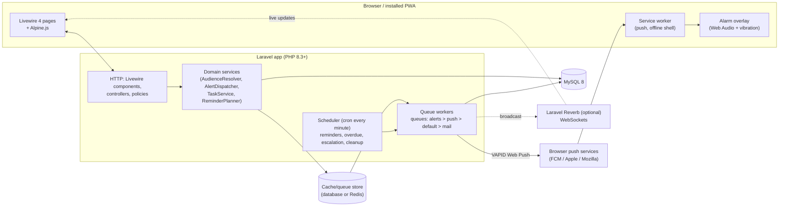
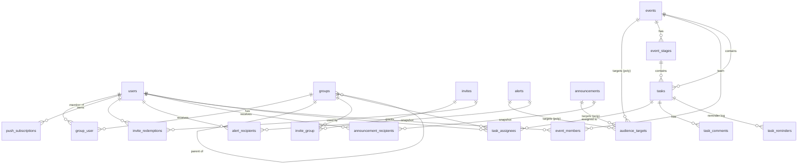

# MCI — Mechaniczne Centrum Informacyjne

**Architecture, data model, permission model and roadmap (v0.3)**

Status: Steps 0–1 merged-ready (PR #1), Step 2 (schools + invites/QR) in progress. Decisions are recorded in §10. Target hosting: **shared PHP hosting** (§2.2). v0.3 adds the **multi-school portal** (§3.0), **visibility & profile privacy** (§3.0.3), **operations: ZIP updates, backups, maintenance** (§11) and **UX: mentions, pill filters, TV mode, presence, bug reports** (§12).

---

## 1. Goals and guiding principles

| Problem today | MCI answer |
|---|---|
| One shared feed/calendar for everyone, lots of noise | Every message, alert and event has an explicit **audience** (groups ∪ users). Users only see what targets them. |
| Urgent safety information can be missed | **Safety alerts** with a priority queue, Web Push, full-screen in-app alarm and **mandatory "Potwierdzam odbiór"** with live tracking. |
| Multi-step school events are run in chats and spreadsheets | **Event → Stage → Task** with deadlines, leads, teams, reminders and overdue alerts, plus personal To-Do. |

Principles:

1. **Audience snapshot at send time.** When something is sent, the union of targeted groups/users is resolved once and written to a per-recipient table. This makes delivery/ack statistics honest ("who *should* have acknowledged") and keeps reads fast.
2. **Environment-driven infrastructure.** Queue driver, broadcasting/real-time mode, mail, VAPID keys, cache — all `.env`. The same code runs on shared PHP hosting (cron only) and on a VPS (Supervisor, Redis, WebSockets).
3. **Progressive real-time.** Real-time is a nice-to-have upgrade, never a dependency. Baseline is Livewire polling; WebSockets (Laravel Reverb) switch on when hosting allows.
4. **Polish-facing UI, English code.** Code, DB and identifiers in English; all UI strings through `lang/pl/*.php` (`APP_LOCALE=pl`, `APP_TIMEZONE=Europe/Warsaw`), so an English UI is free later.
5. **Small, boring dependencies.** Prefer first-party Laravel packages and a few well-maintained community ones.
6. **One portal, many schools.** A single installation serves several schools. Every school-owned row carries `school_id`; the user works in one *active school* at a time but sees cross-school items (e.g. calendar) where visibility allows (§3.0).
7. **Privacy by default.** A user's own choice decides how visible their profile is outside their school, capped by the school's policy (§3.0.3). Nothing about a person is public unless they opt in and the school allows it.

---

## 2. System architecture



### 2.1 Tech choices

| Concern | Choice | Notes |
|---|---|---|
| Framework | Laravel 13, PHP 8.3+ | Plain skeleton + Fortify (the official starter kit lagged behind Laravel 13 / Livewire 4 at the time). |
| UI | Livewire 4 (+ Alpine.js bundled), Tailwind CSS v4, Vite | Class-based Livewire page components (`app/Livewire`), Blade components for UI primitives. System font stack (no font CDN). |
| UI kit | **Flux UI (free tier)** for inputs, modals, dropdowns, tables; own Blade components for domain widgets | Flux is the official Livewire kit and plays well with `wire:model`. If you prefer zero vendor UI, the same layout works with plain Blade components (see §8). |
| Auth | Laravel Fortify: e-mail + password login, password reset / account set-up links, no public registration | 2FA for privileged roles planned in Step 9. |
| RBAC | `spatie/laravel-permission` for global roles & permissions | Group/event-scoped leadership is modelled in our own pivots (§4). |
| Web Push | `laravel-notification-channels/webpush` (uses `minishlink/web-push`) | VAPID keys in `.env`. Push subscriptions table from the package. |
| Queues | `QUEUE_CONNECTION=database` by default, `redis` on VPS | Named queues: `alerts`, `push`, `default`, `mail`. |
| Real-time | `BROADCAST_CONNECTION=null` + `wire:poll` (baseline) or `reverb` (VPS) | Alert ack board polls every 3 s in baseline mode; pushes instantly with Reverb. |
| QR codes | `simplesoftwareio/simple-qrcode` (or `bacon/bacon-qr-code`) | For invite links, printable PDF/PNG. |
| Audit | own `audit_logs` table (`App\Support\Audit::log()`) | Accounts, access, groups, settings now; alerts later. |
| Tests / quality | Pest, Laravel Pint, GitHub Actions CI on SQLite **and MySQL 8** | Larastan can be added later. |

### 2.2 Deployment profiles

**Decision: the school uses shared PHP hosting (Profile A).** Everything must work with PHP + MySQL + one cron entry. Profile B stays possible by changing `.env` only. Step-by-step instructions: [`DEPLOYMENT.md`](DEPLOYMENT.md).

| | **Profile A — shared hosting (default, target)** | **Profile B — VPS (optional later)** |
|---|---|---|
| Cron | `* * * * * php artisan schedule:run` | same |
| Queue | `QUEUE_CONNECTION=database`, `MCI_QUEUE_VIA_SCHEDULER=true`: the scheduler starts `queue:work --stop-when-empty --max-time=50 --queue=alerts,push,default,mail` every minute (`routes/console.php`). Fallback: a second cron line running the same command if the host forbids process spawning. | `redis`; Supervisor keeps `queue:work` running, `MCI_QUEUE_VIA_SCHEDULER=false` |
| Real-time | `MCI_REALTIME=poll`: Livewire `wire:poll` every `MCI_POLL_SECONDS` (5 s default; 3 s on the alert ack board) | `MCI_REALTIME=broadcast` + Laravel Reverb |
| Cache / session | `database` / `database` | `redis` |
| Alert latency | Queue work starts within ~60 s, so **alerts never wait for cron**: the first push batch is dispatched after the HTTP response (`dispatch()->afterResponse()`), remaining batches and escalations go through the queue. Open apps also poll for active alerts. | seconds |

Every UI feature that would use WebSockets must have a polling path; this is a hard rule for Steps 3–8.

### 2.3 Application layout

```
app/
  Domain/
    Audience/        AudienceResolver, AudienceTarget value objects
    Alerts/          AlertDispatcher, Actions/SendAlert, Actions/AcknowledgeAlert
    Announcements/   Actions/PublishAnnouncement
    Events/          Actions/CreateEvent, StageService
    Tasks/           TaskService, ReminderPlanner
    Invites/         InviteService (redeem, QR generation)
  Models/            Eloquent models (thin; relationships, casts, scopes)
  Policies/          one policy per aggregate (Alert, Event, Task, Group, Invite…)
  Jobs/              SendAlertPushBatch, SendTaskReminder, MarkOverdueTasks, EscalateUnacknowledgedAlert…
  Notifications/     AlertRaised, TaskAssigned, TaskDueSoon, TaskOverdue, AnnouncementPublished
  Events/ Listeners/ AlertAcknowledged (broadcast), TaskCompleted…
  Enums/             AlertSeverity, TaskStatus, GroupRole, EventRole, Permission…
resources/views/
  components/ui/     own primitives (card, badge, stat, empty-state, page-header)
  components/app/    domain widgets (alert-banner, ack-progress, task-row, audience-picker)
  layouts/           app.blade.php (sidebar + topbar + bottom nav on mobile), guest.blade.php
  livewire/          pages grouped by module: dashboard/, alerts/, events/, tasks/, groups/, admin/
lang/pl/             all UI strings
public/              manifest.webmanifest, sw.js, icons/, sounds/alarm.mp3
```

Business logic lives in `Domain/*` action classes so Livewire components stay thin and logic is testable without the UI.

---

## 3. Database schema (MySQL 8, InnoDB, utf8mb4)

Conventions: `id` BIGINT UNSIGNED PK, `created_at/updated_at`, soft deletes where stated, all FKs indexed, enums stored as `VARCHAR` backed by PHP enums (easier migrations than MySQL `ENUM`).

### 3.0 Schools and tenancy (multi-school portal)

MCI is **one portal** for several schools. A person has one account (one e-mail, one password) and may belong to several schools, with different roles in each (e.g. *Koordynator* in ZSM, *Nauczyciel* in a partner school).

#### 3.0.1 Tables

**`schools`**
| column | type | notes |
|---|---|---|
| id | bigint PK | |
| name, short_name | varchar(150) / varchar(20) | |
| slug | varchar(100) unique | used in URLs and public calendar links |
| city | varchar(100) null | |
| email_domains | json null | e.g. `["zsm.edu.pl"]` — self-registration via group QR is limited to these domains |
| settings | json null | school policy: max profile visibility, self-registration on/off, default invite expiry… |
| logo_path, color | null | per-school badge in the switcher / calendar |
| is_active | bool | inactive schools are hidden, their invites stop working |
| timestamps, deleted_at | | |

**`school_user`** — `school_id`, `user_id` (PK pair), `status` (`active`, `suspended` — suspension per school), `joined_via` (`admin`, `import`, `invite`, `self`), `invite_id`, timestamps. A user is *in* a school only through this row.

Changes to Step-1 tables:
- `groups.school_id` (FK, required): groups always belong to one school; slugs are unique per school.
- `users.is_site_admin` (bool): platform operator (installs updates, manages schools, sees the site journal). Not a Spatie role, so it cannot be granted by a school.
- `users.profile_visibility`, `users.profile_fields` (§3.0.3).
- `audit_logs.school_id` (nullable): `null` = **Dziennik witryny** (site journal), set = **Logi szkoły** (§3.7).
- Spatie permission **teams** enabled with `school_id` as the team key: roles are defined once (global, `school_id = null`) and **assigned per school** in `model_has_roles.school_id`; direct grants such as `alerts.send` are per school too.

#### 3.0.2 Active school context

- `App\Support\CurrentSchool` holds the active school, resolved per request by middleware from the session (fallback: the user's first active school). It also calls `setPermissionsTeamId()` so every `can()` is evaluated **in that school**.
- A **school switcher** (sidebar header, `Ctrl/⌘ K` later) changes the active school without a full reload; the choice is remembered per user.
- Lists (users, groups, invites, logs) are always scoped to the active school. Cross-school views (calendar, "my tasks", alerts) query *all* the user's schools and show a school badge + pill filter `Szkoła: ZSM · ZS2 · wszystkie`.
- A user who belongs to no school sees an empty-state page with "Masz kod zaproszenia?" (Step 2 join flow).

#### 3.0.3 Visibility levels

Content visibility (events, later announcements and calendar entries):

| Level | Who sees it | Typical use |
|---|---|---|
| `public` | anyone, without logging in (public calendar page `/kalendarz/{school-slug}`, iCal feed) | open days, competitions, recruitment |
| `inter_school` | logged-in users of **any** school in the portal | joint events of partner schools |
| `school_only` | active members of the owning school | staff meetings, school-wide events |
| `private_group` | only the selected audience (groups ∪ users, §3.3) | team work, sensitive planning |

Refinements: (1) the default for new items is `school_only`; (2) only users with `events.publish_public` may choose `public` (prevents accidental publication); (3) `public` items expose only title, date, place and a public description field — never participants, tasks or comments.

**Profile visibility** — the person decides first, the school sets the ceiling:

| Level (`users.profile_visibility`) | Visible to |
|---|---|
| `school` *(default)* | members of the schools the user belongs to |
| `network` | also logged-in users of other schools in the portal (e.g. for joint events, `@mentions` across schools) |
| `public` | also the public pages (e.g. as an event contact); name + school only |

- `users.profile_fields` (json) lets the person choose which fields are shown beyond their name: e-mail, phone, groups, photo. Default: name + groups only, e-mail visible inside own school.
- School policy `settings.max_profile_visibility` (set by users with `settings.manage` in that school, e.g. the principal) caps the effective level: **effective = the stricter of (user choice, strictest cap among the user's schools)**. Changing the cap never widens anyone's visibility silently; it only narrows.
- Enforced in one place, `ProfilePolicy::view($viewer, $profile)`, used by mentions, member lists and public pages. Changes are logged in the school log.

### 3.1 Entity–relationship overview



### 3.2 Identity, roles, groups

**`users`**
| column | type | notes |
|---|---|---|
| id | bigint PK | |
| first_name, last_name | varchar(100) | |
| email | varchar(191) unique | login |
| phone | varchar(32) null | future SMS fallback |
| password | varchar null | null until invite redeemed / set |
| status | varchar(20) | `invited`, `active`, `suspended` — index |
| last_seen_at | timestamp null | |
| locale | varchar(5) default `pl` | |
| notification_prefs | json null | quiet hours, email digest on/off (alerts ignore quiet hours) |
| two_factor_* | (Fortify columns) | |
| email_verified_at, remember_token, timestamps, deleted_at | | soft delete |

**Spatie tables** — `roles`, `permissions`, `model_has_roles`, `model_has_permissions`, `role_has_permissions` (standard, `guard_name=web`).

**`groups`**
| column | type | notes |
|---|---|---|
| id | bigint PK | |
| parent_id | FK groups null | optional hierarchy (e.g. *Nauczyciele zawodowi* under *Nauczyciele*). Targeting a parent does **not** auto-include children unless `include_subgroups` is chosen on the target (§3.4). |
| name | varchar(150) | |
| slug | varchar(150) unique | |
| type | varchar(30) | `staff`, `subject`, `vocational`, `class_tutors`, `class`, `volunteering`, `sport`, `custom` — index |
| description | text null | |
| color | varchar(7) null | UI chip colour |
| is_system | bool | e.g. *Wszyscy pracownicy* — cannot be deleted |
| membership_mode | varchar(20) | `managed` (only leaders/admins add), `invite` (QR/invite), `open` (self-join) |
| created_by | FK users | |
| timestamps, deleted_at | | |

**`group_user`** (pivot)
| column | type | notes |
|---|---|---|
| group_id | FK | PK (group_id, user_id) |
| user_id | FK | index |
| role | varchar(20) | `member`, `leader` (GroupRole enum) |
| joined_via | varchar(20) | `admin`, `invite`, `self` |
| invite_id | FK invites null | |
| timestamps | | |

**`invites`** (QR / token onboarding — implemented in Step 2)
| column | type | notes |
|---|---|---|
| id | bigint PK | |
| school_id | FK schools | invite always joins one school |
| token_hash | char(64) unique | SHA-256 of the token; lookups never use the plain token |
| token | text (encrypted) | kept encrypted (APP_KEY) so a poster can be re-printed; never logged |
| allow_self_registration | bool | group links only: a new person may create an account (domain rules apply) |
| kind | varchar(20) | `personal` (bound to one email/user, single use), `group_link` (multi-use poster QR) |
| email | varchar(191) null | for personal invites |
| user_id | FK users null | pre-provisioned account the invite activates |
| role_name | varchar(50) null | school role granted on redeem (e.g. `teacher`); only creators with `roles.manage` may set it; `admin` only on personal invites |
| max_uses | int null | null = unlimited |
| uses_count | int default 0 | |
| expires_at | timestamp null | index |
| revoked_at | timestamp null | |
| created_by | FK users | |
| timestamps | | |

**`invite_group`** — `invite_id`, `group_id`, `group_role` (`member`/`leader`). One invite can add the user to several groups at once.

**`invite_redemptions`** — `id`, `invite_id`, `user_id`, `redeemed_at`, `ip`, `user_agent`. Audit + limit enforcement.

**`push_subscriptions`** (from webpush package) — `subscribable_type/id`, `endpoint` (unique, ASCII 1024), `public_key`, `auth_token`, `content_encoding`, plus our extras: `device_label`, `platform` (`ios`, `android`, `desktop`), `last_success_at`, `failed_at`. Dead endpoints (HTTP 404/410) are deleted automatically.

### 3.3 Audience targeting (shared by alerts, announcements, events)

**`audience_targets`** (polymorphic owner, polymorphic target)
| column | type | notes |
|---|---|---|
| id | bigint PK | |
| owner_type, owner_id | morph | `alert`, `announcement`, `event` — index |
| target_type | varchar(20) | `group`, `user`, `role`, `everyone` |
| target_id | varchar(40) null | group/user id, role **name** (e.g. `teacher`); null for `everyone` |
| include_subgroups | bool default false | for group targets |

`App\Domain\Communication\Audience` (Step 3) is built from compact keys — `everyone`, `role:teacher`, `group:5`, `group+:5` (with subgroups), `user:9` — and `resolve($school)` returns the **deduplicated union** of active users who are active members of that school, in one query; the sender is excluded and the result is bulk-inserted into the owner's `*_recipients` table in chunks of 1 000. `AudienceGuard` decides which keys an author may use (§4.3) and is enforced server-side in the publishing action, never only in the form.

### 3.4 Announcements (targeted information feed)

**`announcements`** — `id`, `school_id` FK, `author_id` FK, `title`, `body` (sanitized HTML from the shared editor, §12.1), `priority` (`normal`, `important`, `urgent`), `requires_confirmation` bool, `is_public` bool (needs `events.publish_public`; shown on the public front), `published_at` (future = scheduled), `expires_at` null, `pinned_until` null, `recipients_count`, timestamps, deleted_at. Index `(school_id, published_at)`.

**`announcement_recipients`** — `announcement_id`, `user_id` (PK pair), `reason` (`audience` / `mention`), `notified_at`, `read_at`, `confirmed_at`. Index `(user_id, read_at)` for the "unread" badge.

**`mentions`** — `source_type/id` (announcement, later tasks/comments/events), `mentionable_type/id` (user or group), `school_id`, `created_by`, `created_at`.

**`notifications`** — Laravel's database notifications: the bell. Only mentions, important/urgent posts and posts requiring confirmation ring it; routine posts appear in the feed only (anti-noise rule). Delivery is the idempotent `DeliverAnnouncement` job (`notified_at`), dispatched on publish and swept every minute by `mci:deliver-announcements` for scheduled posts.

**`attachments`** (polymorphic, reused by announcements/tasks/events) — `attachable_type/id`, `disk`, `path`, `original_name`, `mime`, `size`, `uploaded_by`.

### 3.5 Safety alerts

**`alert_templates`** — `id`, `name`, `severity`, `title`, `body`, `default_targets` json, `sound` varchar, `is_active`. Pre-defined e.g. *Ewakuacja*, *Zagrożenie – zostań w sali (lockdown)*, *Pożar*, *Odwołanie alarmu*. Lets an authorised user fire an alert in two taps.

**`alerts`**
| column | type | notes |
|---|---|---|
| id | bigint PK | |
| uuid | char(36) unique | used in push payloads / URLs |
| template_id | FK null | |
| sender_id | FK users | |
| severity | varchar(20) | `info`, `warning`, `critical` |
| title | varchar(150) | |
| body | text | |
| requires_ack | bool default true | |
| status | varchar(20) | `dispatching`, `active`, `resolved`, `cancelled` — index |
| is_drill | bool default false | *Ćwiczenia* — same flow, separate stats, clear label |
| ack_deadline_minutes | smallint null | triggers escalation (re-push) to non-acknowledged |
| recipients_count | int | denormalized for fast stats |
| acknowledged_count | int | incremented atomically on ack |
| sent_at, resolved_at | timestamp null | |
| resolved_by | FK users null | |
| parent_alert_id | FK alerts null | follow-up / "all clear" linked to original |
| timestamps | | (no soft delete — alerts are an audit record) |

**`alert_recipients`** (the per-recipient tracking the sender watches live)
| column | type | notes |
|---|---|---|
| id | bigint PK | |
| alert_id | FK | |
| user_id | FK | unique (alert_id, user_id) |
| push_status | varchar(20) | `pending`, `sent`, `failed`, `no_subscription` |
| push_sent_at | timestamp null | when push service accepted the message |
| delivered_at | timestamp null | service worker reported receipt (best-effort, see §6) |
| opened_at | timestamp null | alert screen opened |
| acknowledged_at | timestamp null | "Potwierdzam odbiór" |
| ack_device | varchar(20) null | `pwa`, `browser`, `email_link` |
| ack_note | varchar(255) null | optional: "Jestem z klasą 2B w sali 14, wszyscy bezpieczni" |
| reminder_count | tinyint default 0 | escalation re-pushes |

Indexes: `(alert_id, acknowledged_at)` for the live board, `(user_id, acknowledged_at)` for "my pending alerts".

### 3.6 Events, stages, tasks, To-Do

**`events`** (multi-stage undertakings, e.g. *Dzień Otwarty*, *Zawody sportowe*, *Akcja charytatywna*)
| column | type | notes |
|---|---|---|
| id | bigint PK | |
| title, description | | |
| status | varchar(20) | `draft`, `planned`, `in_progress`, `completed`, `cancelled` — index |
| starts_at, ends_at | datetime null | appear in recipients' calendar |
| location | varchar(150) null | |
| owner_id | FK users | creator |
| lead_user_id | FK users null | responsible person |
| lead_group_id | FK groups null | responsible team (e.g. *Wolontariat*) |
| school_id | FK schools | owning school |
| visibility | varchar(20) | `public`, `inter_school`, `school_only` (default), `private_group` — see §3.0.3 |
| timestamps, deleted_at | | |

**`event_members`** — `event_id`, `user_id`, `role` (`lead`, `coordinator`, `member`, `viewer`). Event-scoped permissions (§4.3). Members of `lead_group_id` are implicitly `member`.

**`event_stages`** — `id`, `event_id` FK, `title`, `description`, `position` smallint, `starts_at` null, `due_date` datetime null, `lead_user_id` null, `lead_group_id` null, `status` (`pending`, `in_progress`, `done`), `completed_at`. Index `(event_id, position)`.

**`tasks`** (one table for personal To-Do and project tasks)
| column | type | notes |
|---|---|---|
| id | bigint PK | |
| event_id | FK null | null = standalone/personal task |
| stage_id | FK null | must belong to event_id (validated in app) |
| parent_id | FK tasks null | optional subtasks/checklist |
| created_by | FK users | |
| title | varchar(200) | |
| description | text null | |
| is_personal | bool | personal To-Do visible only to creator |
| priority | tinyint | 1 low … 4 urgent |
| status | varchar(20) | `todo`, `in_progress`, `blocked`, `done`, `cancelled` |
| due_date | datetime null | |
| remind_before_minutes | int null | custom reminder; default from settings |
| completed_at, completed_by | null | |
| position | int | ordering inside a stage / list |
| timestamps, deleted_at | | |

Indexes: `(status, due_date)` for overdue scans, `(event_id, stage_id, position)`, `(created_by, is_personal)`.

**`task_assignees`** — `id`, `task_id`, `user_id` null, `group_id` null (exactly one set; CHECK constraint), `assigned_by`, `assigned_at`. A group assignment means "any member of the team"; the dashboard shows it to all members, and completion by one member completes it (option for per-member completion later).

**`task_comments`** — `id`, `task_id`, `user_id`, `body`, timestamps.

**`task_reminders`** (idempotency log so the scheduler never sends twice) — `id`, `task_id`, `user_id`, `type` (`due_soon`, `due_today`, `overdue`, `overdue_daily`), `sent_at`. Unique `(task_id, user_id, type, DATE(sent_at))` via a `sent_on` date column.

### 3.7 Cross-cutting

- **`notifications`** — Laravel's database notifications table (in-app bell / notification centre for everything that is not an alert).
- **`audit_logs`** — `school_id` (null = site), `actor_id`, `action`, `subject_type/id`, `properties` json, `ip`, `created_at`. Two views over one table:
  - **Dziennik witryny** (site journal, site admins): schools created/changed, updates installed, backups, maintenance windows, site-admin grants, appearance.
  - **Logi szkoły** (school log, `audit.view` in that school): accounts, roles/permissions, groups, invites, alerts, events.
  - Both have instant pill filters (category, actor, date range presets), full-text search over action/subject, and **reports**: CSV export and a printable report view (e.g. "zmiany uprawnień w październiku"). Indexes `(school_id, created_at)` and `(school_id, action)`.
- **`bug_reports`** — `school_id`, `user_id`, `url`, `user_agent`, `viewport`, `message`, `screenshot_path` null, `status` (`new`, `in_progress`, `resolved`), `resolved_by` — from the "Zgłoś błąd do administratora" button (§12).
- **`settings`** — key/value json for school-wide settings (school name, default reminder offsets, alert escalation defaults, quiet hours).
- Laravel defaults: `jobs`, `job_batches`, `failed_jobs`, `cache`, `sessions`, `password_reset_tokens`.

---

### 3.8 Editable event categories and group types

**`taxonomy_terms`** — `kind` (`event_category` | `group_type`), `school_id` (null = site-wide list), `key` (unique per kind and list, never changes), `name`, `icon` (monochrome Heroicon from a fixed list), `color` (group types only), `position`, `is_active`. `events.category` and `groups.type` store the key; the built-in keys are inserted as site-wide terms by the migration, so old data stays valid.

- A school sees the site-wide list minus the keys it hid (`schools.settings.taxonomy_hidden.{kind}`) plus its own terms. Own terms and hiding need the feature switches `events.school_categories` / `groups.school_types` (site-controlled, on by default).
- Archived terms are not offered for new records; records already using them keep showing them. Only unused terms can be deleted.
- Screens: *Witryna → Kategorie i typy* (site admin) and *Administracja → Kategorie i typy* (permission `categories.manage`). Logic in `App\Domain\Catalog\Actions\ManageTerms`; every change is logged (`catalog.*`) in Dziennik witryny or Logi szkoły.

## 4. Permission & group model

Four layers, checked together in Laravel **Policies**:

0. **Site admin** (`users.is_site_admin`). *Do you operate the platform?* Schools, updates, backups, site journal, appearance.
1. **School role → permissions** (Spatie with teams; evaluated in the active school). *What are you in this school?*
2. **Group role** (`group_user.role` = `leader`/`member`). *Which teams do you lead?*
3. **Event role** (`event_members.role`). *What is your part in this event?*

### 4.1 School roles (seeded once, assigned per school)

| Role (PL label) | Intended for |
|---|---|
| `admin` (*Administrator szkoły*) | principal / school IT — everything **within the school** |
| `coordinator` (*Koordynator*) | vice-principal, safety officer, event coordinators |
| `teacher` (*Nauczyciel*) | all teaching staff |
| `staff` (*Pracownik*) | administration, support staff |
| `student` (*Uczeń*) | **later** — schema-ready, no permissions in MVP |

### 4.2 Permissions (seeded)

| Permission | admin | coordinator | teacher | staff |
|---|:-:|:-:|:-:|:-:|
| `users.manage` (create, suspend, assign roles) | ✓ | | | |
| `groups.manage` (any group) | ✓ | ✓ | | |
| `invites.create` | ✓ | ✓ | | |
| `announcements.publish.any` (any audience) | ✓ | ✓ | | |
| `announcements.publish.own_groups` | ✓ | ✓ | ✓ | |
| `alerts.send` | ✓ | * | | |
| `alerts.send.drill` | ✓ | ✓ | | |
| `alerts.view_all_stats` | ✓ | ✓ | | |
| `events.create` | ✓ | ✓ | ✓ | |
| `tasks.assign.any` | ✓ | ✓ | | |
| `stats.view` | ✓ | ✓ | | |
| `roles.manage` (grant roles / individual permissions) | ✓ | | | |
| `audit.view` | ✓ | ✓ | | |
| `settings.manage` (school policy: profile-visibility cap, self-registration, domains) | ✓ | | | |
| `events.publish_public` | ✓ | ✓ | | |

\* **Decision:** `alerts.send` is not part of any role except admin. It is granted **directly to individual users** (Spatie direct permissions) by someone with `roles.manage`, e.g. the safety officer or reception. The admin user form has an "Uprawnienia indywidualne" panel for this. Coordinators get only `alerts.send.drill` by default.

Students (`student` role) exist in the schema but have no permissions and are optional in phase one; student accounts can be imported or created later without schema changes. Group type `class` is ready for school classes.

The matrix is seeded from `App\Enums\Role::defaultPermissions()`. The seeder is idempotent and does not overwrite later changes an admin made to a role.

\* `alerts.send` can also be granted **directly to an individual user** (Spatie direct permissions), e.g. the school safety inspector, without making them a coordinator. That matches "triggerable only by users with explicit permission".

### 4.3 Scoped rules (Policies)

- **Group leader** may: add/remove members of *their* group, create invites for *their* group, publish announcements to *their* group, assign tasks to *their* group or its members.
- **Event lead / coordinator** (`event_members.role in [lead, coordinator]` or `events.lead_user_id`, or leader of `events.lead_group_id`) may: edit the event, manage stages, create tasks inside it and assign them to event members or the lead group.
- **Event member** may: see the event, update status of tasks assigned to them or their group, comment.
- **Everyone** may: create personal To-Do (`is_personal = true`, visible only to them), see items they are a recipient/assignee of, acknowledge alerts.
- **Assigning a task to someone else** requires one of: `tasks.assign.any`; being event lead/coordinator (inside that event); being leader of the target group (for group or member assignment).
- **Invites can never grant more than the creator has**: a group leader's invite may only add to groups they lead and may not set a global role; only `users.manage` may set `role_name = coordinator/admin`.

Policy example (sketch):

```php
// TaskPolicy
public function assign(User $user, Task $task, User|Group $assignee): bool
{
    if ($user->can('tasks.assign.any')) return true;
    if ($task->event && $user->leadsEvent($task->event)) return $task->event->hasParticipant($assignee);
    return $assignee instanceof Group
        ? $user->leadsGroup($assignee)
        : $user->leadsAnyGroupContaining($assignee);
}
```

Group/event leadership lookups are cached per request (`$user->ledGroupIds()` memoized) to avoid N+1 policy queries.

---

## 5. Key flows

### 5.1 Onboarding

1. **Central provisioning** — admin imports a CSV or adds users manually in the active school → accounts `status=invited` + e-mail with a set-password link.
2. **QR / invite link** — a user with `invites.create`, or a group leader for their own groups, creates an invite: one school, one or several groups (member or leader), optional role (only with `roles.manage`), expiry, max uses → the app shows a QR code, a printable A4 poster and a copyable link.
3. Visiting `/join/{token}` (rate-limited, token looked up by SHA-256 hash, invalid/expired/revoked/used-up all show the same neutral page):
   - logged in → confirmation "Dołączysz do: ZSM — Wychowawcy, Wolontariat" → school membership, groups and role added in one transaction; existing leader roles are never downgraded;
   - personal invite → bound to its e-mail; a different logged-in account is refused; a not-yet-activated account sets its password here and is activated;
   - group link + guest → "Mam konto" (login, then back to the invite) or "Utwórz konto" if the invite allows self-registration **and** the e-mail matches the school's domains (when configured); the new account must confirm its e-mail via a signed link before it can log in.
   - every redemption is recorded (`invite_redemptions`, school log) and `uses_count` is incremented under a row lock, so `max_uses` cannot be exceeded by parallel scans.
4. After first login: **onboarding wizard** — install PWA, enable notifications, test alarm sound (§6.3).

### 5.2 Sending a safety alert

```mermaid
sequenceDiagram
    participant S as Sender (alerts.send)
    participant App as Laravel
    participant Q as Queue "alerts"
    participant P as Push services
    participant R as Recipient device
    S->>App: choose template / audience, confirm (2-step "Wyślij alarm")
    App->>App: create alert (dispatching), resolve audience → alert_recipients
    App->>Q: SendAlertPushBatch jobs (chunks of 200), afterResponse fallback
    Q->>P: Web Push (TTL short, urgency=high, VAPID)
    P->>R: push event → service worker shows notification (requireInteraction)
    R->>App: POST /alerts/{uuid}/delivered (from SW, best-effort)
    R->>App: open → full-screen alarm + sound → "Potwierdzam odbiór"
    App-->>S: live board updates (poll 3 s / Reverb)
    Note over App,Q: Scheduler: no ack after N min → re-push + e-mail; sender sees "Brak potwierdzenia" list
```

- Confirmation dialog prevents accidental sends; drills are labelled *ĆWICZENIA* everywhere.
- The live board shows: recipients, push sent, delivered, opened, acknowledged, with times; filter "not acknowledged"; per-group breakdown (e.g. "Wychowawcy: 18/22").
- "All clear" (*Odwołanie alarmu*) is a linked follow-up alert that also closes the original.

### 5.3 Task reminders & overdue

Scheduler (`routes/console.php`):

| Schedule | Job |
|---|---|
| every minute | `queue:work --stop-when-empty` (Profile A only) |
| every minute | `EscalateUnacknowledgedAlerts` |
| every 15 min | `SendDueSoonReminders` (due within `remind_before_minutes`, default 24 h and 1 h) |
| daily 07:00 | `SendDailyDigest` (my tasks today, overdue, unread important announcements) |
| hourly | `MarkOverdueTasks` → notify assignee once, then daily; notify event lead when a task is overdue > 24 h |
| daily 03:00 | prune dead push subscriptions, expired invites, old drill alert recipients (retention per settings) |

All reminder sends go through `task_reminders` for idempotency.

---

## 6. PWA, Web Push and the "silent phone" reality

### 6.1 PWA

- `manifest.webmanifest` (name *MCI*, `display: standalone`, theme colours, maskable icons), `sw.js` hand-written (small; no Workbox needed initially): caches the app shell + offline page, handles `push` and `notificationclick`.
- Install prompts: Android/desktop via `beforeinstallprompt`; **iOS shows manual instructions** (Share → *Do ekranu początkowego*), because on iPhone Web Push only works for a PWA added to the Home Screen (iOS/iPadOS 16.4+).

### 6.2 Push

- VAPID keys: `VAPID_PUBLIC_KEY`, `VAPID_PRIVATE_KEY`, `VAPID_SUBJECT` in `.env` (`php artisan webpush:vapid` generates them).
- Alert pushes: `urgency: high`, short TTL (e.g. 10 min), `requireInteraction: true`, `vibrate` pattern, `tag` = alert uuid (so re-pushes replace, not stack), `renotify: true` on escalation.
- Every user can register multiple devices; the settings page lists them with a **"Wyślij testowe powiadomienie"** button.

### 6.3 What we can and cannot do on silent / Do Not Disturb

What browsers **do not allow** (iOS and Android): a web app cannot override silent mode or DND, cannot play custom sound from a push notification while the app is closed, cannot use critical-alert entitlements (those are native-app only). Notification sound, when the phone is not muted, is the system default.

What MCI **does** (best-effort, layered):

1. **Push notification** with high urgency, vibration (Android), persistent (`requireInteraction`) — this is what reaches a closed app.
2. **Full-screen alarm state** whenever the app is open or opened from the notification: red full-screen overlay, large title, pulsing, the ack button, cannot be dismissed without acknowledging (critical) or explicit "Zamknij" (info).
3. **Audio**: Web Audio API alarm tone (generated oscillator — no file needed) plus `<audio>` fallback with `alarm.mp3`, looping until ack. Browsers require a prior user gesture to unlock audio, so the onboarding "Testuj alarm" button and any tap in the app unlock the `AudioContext`; when opened from a notification click the page is already user-activated on most platforms. Plays at media volume — **media volume is independent of the ringer switch on many devices**, which is our best chance on a muted phone.
4. `navigator.vibrate()` (Android; unsupported on iOS), Screen Wake Lock API to keep the alarm visible, Badging API for the unread count.
5. **Polling safety net**: while the app is open, a lightweight check every 15–30 s for active unacknowledged alerts (covers lost pushes).
6. **Escalation**: unacknowledged after N minutes → re-push + e-mail (and SMS later, if a gateway is added — column `users.phone` is ready).
7. **In-app setup guidance** (*Przewodnik konfiguracji*), platform-specific: install PWA, allow notifications, Android — set the MCI notification channel to "priority"/allow over DND; iOS — add MCI to allowed apps in Focus modes, keep notifications on "Immediate delivery"; a self-test that sends a real push and records the result per device. The admin stats page shows *"X users have no working push subscription"* so the school can follow up.

Honest summary for staff: *MCI reaches you reliably when notifications are allowed; it cannot force a sound on a muted phone. In a real emergency the school's physical alarm system remains primary.*

---

## 7. Dashboard & statistics

**My workspace (`/`)** — cards:
- Active alerts needing my acknowledgment (sticky red banner on every page).
- My tasks: overdue / today / this week (personal + assigned + via my groups).
- Upcoming deadlines in events I belong to (stage and task due dates).
- Unread / to-confirm announcements.
- For senders: my recent alerts with ack progress bars.
- Mini calendar: events I am in or targeted by.

**Statistics (`stats.view`)**:
- Alerts: ack rate, median & p90 time-to-ack, per group, real vs drill, trend per month; push reach (users with active subscription).
- Tasks: completion rate and overdue count by event, by stage, by team; burn-down per event.
- Engagement: announcement read rates.
- Queries are aggregate SQL over the snapshot tables (indexed); results cached 5 min. Charts: a small JS lib (e.g. Chart.js or ApexCharts) via Alpine.

---

## 8. UI approach

- **Layout**: desktop sidebar (Pulpit, Alarmy, Ogłoszenia, Wydarzenia, Zadania, Kalendarz, Grupy, Administracja), mobile **bottom navigation** with 4–5 items and a prominent alert badge — this is a phone-first app for staff.
- **Components**: Flux (free) for form controls, tables, modals, dropdowns, toasts + our `x-ui.*` primitives (`page-header`, `stat`, `empty-state`) + `x-app.*` domain widgets (`brand`, `user-menu`, `group-chip`). Dark mode via Flux appearance (`class` strategy).

### 8.1 Configurable theming (decision)

Three layers, so the school can re-brand without a developer or a rebuild:

1. **Design tokens** in `resources/css/app.css` (`@theme`): `--color-primary`, `--color-primary-foreground`, `--color-danger`, `--radius-mci`, each reading a runtime CSS variable (`var(--mci-primary, <fallback>)`). Use them as Tailwind utilities: `bg-primary`, `text-primary-foreground`, `bg-danger`, `rounded-mci`.
2. **Runtime variables**: `App\Support\Appearance` merges `config/mci.php` defaults with the `appearance` row of the `settings` table and prints a `<style>` block in `<head>` with `--mci-*` and Flux's `--color-accent*` variables. Flux buttons, links, checkboxes and our own components all follow the school colour. Values are validated as `#rrggbb` and sanitised again on output.
3. **Admin screen** *Administracja witryny → Wygląd* (site admins; per-school colour/logo badges live in school settings): school name and short name, logo upload, primary colour, text-on-primary colour, alarm colour, corner radius (none → xl), default theme (system / light / dark), live preview, reset to defaults. Users can still choose their own light/dark mode in the user menu.

Adding a new option = add a default in `config('mci.appearance')`, a field on the screen and, if visual, a CSS variable in `Appearance::cssVariables()`.
- **Audience picker** (`livewire/components/audience-picker`): searchable multi-select of groups (chips coloured by type) + individual users, showing live "Odbiorców: 47" count from the resolver before sending — this is the core UX fix for the "noise" problem.
- Livewire 4 conventions: full-page components for routes, `#[Computed]` for queries, lazy loading for dashboard cards, `wire:poll.visible` only on the ack board/badges.
- Accessibility: large tap targets on the alarm screen, colour + text (not colour alone) for statuses.

---

### 8.2 Feature switches (site and school level)

Every module and option that a school might not want is a case of `App\Enums\Feature` (labels in `lang/pl/features.php`): communication (komunikaty, wzmianki, obrazy, potwierdzenia, planowanie, komunikaty publiczne), events (moduł, publiczne, okładki, iCal), public front (portal, oferta, tryb TV), groups and onboarding (samodzielne dołączanie, logo grup, zaproszenia, kody QR) and the image editor (usuwanie tła). New features add a case; nothing else is needed to make them switchable.

- **Site level** (*Witryna → Funkcje*, site admins): per feature `on` (master switch — off means off in every school) and `override` (whether schools may change it). Stored in the `features` setting.
- **School level** (*Administracja → Funkcje szkoły*, `settings.manage`): the school's own on/off, only where the site allows it; locked or site-disabled features are shown read-only with the reason. Stored in `schools.settings.features`.
- Effective value = parent module on **and** site on **and** (override not allowed **or** school value, default on). Resolved by `App\Support\Features` (memoised per request).
- Enforcement is server-side, not only in menus: route middleware `feature:<key>` (404), the publishing actions (`PublishAnnouncement` rejects images / scheduling / public posts, strips mentions), policies (`GroupPolicy::join`), public queries (`publiclyVisible` / `publiclyListed` exclude schools with the portal or public events off) and `@feature('<key>')` in views.
- Every change is audited: `features.site_updated` in the site journal, `school.feature_updated` in the school log.

---

## 9. Implementation roadmap

Each step ends with migrations + seeders + Pest tests + a short demo, and is its own PR.

| Step | Scope | Done when |
|---|---|---|
| **0. Foundations** ✅ | Laravel + Livewire starter kit, Tailwind v4, Flux, PL locale & timezone, Pint/Larastan/Pest, GitHub Actions CI, `.env.example` for both deployment profiles, base layout (sidebar + bottom nav), README with local setup | `composer test` green in CI; login works in Polish |
| **1. Users, roles, groups** ✅ | users extension, Spatie roles/permissions seeder, groups + `group_user`, admin screens (users CRUD, CSV import, group management, membership), policies for groups, audit log | admin can provision staff and put them into multiple groups; leaders manage own groups |
| **2. Schools + invites & QR onboarding** ✅ | schools, `school_user`, per-school roles (Spatie teams), active-school switcher, site vs school logs; invites (personal / group link), multi-group joining, `/join/{token}`, QR + printable poster, expiry/limits/revoke, self-registration with domain rules + e-mail confirmation | a teacher scans a poster QR and lands in 3 groups of the right school |
| **3. Public front + communication centre** ✅ | public portal (schools, offers, public events and announcements, pill filters, iCal, TV board, entry points for login / invite code / TV); events core with the visibility levels; personalised communication centre (audience union of groups, roles and people, `@user` / `@group` mentions in a shared editor, read/unread, priority, confirmation, scheduling, pinning, polling bell) | a post to "Wychowawcy ∪ @Jan Kowalski" reaches exactly those people, and a guest sees only public content |
| **4. PWA + Web Push** ✅ | manifest, service worker, install guidance (incl. iOS), push subscriptions, test push, VAPID config; push hooks into `DeliverAnnouncement`; image optimisation & caching (§12.4) | installed PWA on Android & iPhone receives a test push |
| **5. To-Do** | personal and assigned tasks (`tasks`, `task_user`), due dates, priorities, checklists, comments with mentions, "Moje zadania" with pill filters (dziś / ten tydzień / zaległe), due-soon and overdue reminders via the scheduler (idempotent reminder log), notification preferences | a coordinator assigns a task to a group; each member sees it in To-Do and gets exactly one reminder |
| **6. Workflow** | reusable multi-stage templates (stage list, default tasks, roles responsible, approvals), stage transitions with sign-off, workflow history in the school log | a "Wycieczka szkolna" template creates its stages and approval steps in one click |
| **7. Project Manager** | events as projects: stages, tasks, team members, kanban + list views, progress, multi-school calendar with pill filters (school / group / status / urgency), `private_group` visibility, iCal feeds per user | multi-stage *Dzień Otwarty* planned with team tasks and shown on the public calendar |
| **8. Safety alerts** | templates, send flow with confirmation, `alerts` queue + after-response first batch, recipient snapshot, full-screen alarm + audio + wake lock, ack, live ack board, escalation, drills, all-clear | drill to 50 users; sender sees acks live; unacked get re-pushed |
| **9. TV mode, dashboard, presence** | signed display tokens for unattended screens (`/tv/{school}`), active-alert takeover, today's deadlines, configurable widgets, online now / recently logged in, workspace dashboard | a hallway TV shows today's events and active alerts |
| **10. Operations** | **daily backups 03:00 Europe/Warsaw, kept 14 days**, **ZIP updates** with manifest/signature/checksums/password/scheduling and advance notice, maintenance page (§11), 2FA for privileged roles, RODO (export, retention), load test of alert fan-out | an update package is scheduled, announced, backed up, applied and can be rolled back |
| **11. Logs, statistics & reports** | search/filters/reports over *Dziennik witryny* and *Logi szkoły*, CSV/PDF export, read/ack statistics for announcements and alerts, visit stats (aggregated, no tracking scripts), "Zgłoś błąd" inbox | a director exports last month's acknowledgement report for one group |

Later / optional: students role, SMS gateway fallback, Google/Microsoft SSO, mobile native wrapper (Capacitor) if critical alerts on silent phones become a hard requirement.

---

## 10. Decisions (answered 2026-11-25)

| # | Question | Decision | Consequence |
|---|---|---|---|
| 1 | Hosting | **Shared PHP hosting** (PHP + MySQL + cron); keep `.env` switchable to a VPS | Profile A is the target (§2.2); polling fallback mandatory; scheduler drains the queue |
| 2 | Login | **E-mail + password**; accounts created by admins (form or CSV import) and, from Step 2, via QR / invite tokens | Fortify without registration; set-up links e-mailed to provisioned staff |
| 3 | Who sends alerts | **Anyone explicitly granted the permission** | `alerts.send` is an individual grant (§4.2), not tied to a role |
| 4 | Scale | **~70 staff** at launch; students added gradually and optionally | `student` role and `class` group type exist; nothing requires student accounts |
| 5 | UI kit | Our call, with **strong configurability** | Flux UI free + Tailwind v4 + runtime design tokens and an appearance screen (§8.1) |
| 6 | Announcements in v1 | Yes if they share the targeting engine | They do (`audience_targets` + `AudienceResolver`, §3.3), so they stay as Step 3, before alerts |
| 7 | One portal or separate installs | **One unified portal, multiple schools**; a user can belong to several schools | §3.0: `schools`, `school_user`, Spatie teams, active-school switcher, cross-school calendar with filters |
| 8 | Event visibility | `public`, `inter_school`, `school_only`, `private_group` kept | Default `school_only`; `public` needs `events.publish_public` and exposes limited fields (§3.0.3) |
| 9 | Profile visibility | **User decides first**, school policy caps it | `profile_visibility` + `profile_fields`, cap in school settings, one `ProfilePolicy` (§3.0.3) |
| 10 | Updates & backups | ZIP updates from the admin panel, password-protected, scheduled, announced; daily backups 03:00, 14 days | §11; site-admin only; pre-update backup + rollback |
| 11 | UX | Mentions everywhere, pill filters, monochrome icons, TV mode, presence, bug reports | §12 |
| 12 | Logs | Separate **Dziennik witryny** and **Logi szkoły** with search, filters and reports | `audit_logs.school_id`, two screens (§3.7) |

### What Step 0 + 1 delivered

- Laravel 13, Livewire 4, Flux, Fortify, Spatie permission, Pest; Polish locale and `Europe/Warsaw`; CI on SQLite and MySQL 8 (also verified locally on MariaDB 10.11).
- Tables: `users` (first/last name, status `invited/active/suspended`, phone, soft deletes), Spatie role/permission tables, `groups` (type, parent, colour, membership mode, system flag), `group_user` (member/leader), `settings`, `audit_logs`.
- Screens: login / forgot password / set password (PL); dashboard; users list with search, filters, suspend, send set-up link; user form with roles, individual permissions and multi-group membership; CSV import with dry-run preview; groups list, detail (members, add/remove, promote leader, join/leave open groups), create/edit; appearance settings; audit log; own profile and password change.
- Rules enforced in policies and covered by 46 tests: suspended users cannot log in and are logged out mid-session; leaders manage members of their own group only; only `groups.manage` promotes leaders; only `roles.manage` changes access and nobody edits their own access; only admins edit admins or grant the admin role; system groups cannot be deleted.
- Seeders: idempotent roles/permissions, starter groups (Wszyscy pracownicy, Nauczyciele, Wychowawcy, Wolontariat…), first admin from `.env`; `DemoSeeder` with 70 staff for local testing.

### What Step 3 delivered

- **Public front** (no login, `throttle:240,1`): `/` with schools, offers and public events/announcements and URL-kept pill filters (school, category, date: dziś / ten tydzień / ten miesiąc / wszystkie); `/szkoly/{slug}` school page with offers by kind; `/publiczne/wydarzenia/{id}` (+ `.ics`), `/publiczne/komunikaty/{id}`; `/tv` full-screen board (clock, today, upcoming, public announcements, `F` / `Esc`). Entry points: login, join by invite code, TV.
- **Safe public preview**: public queries select only whitelisted columns (`Event::PUBLIC_COLUMNS`), require `visibility = public`, a non-cancelled status and an active, listed school (`schools.is_listed`); everything else is a plain 404. People mentioned in public posts are shown as "@…" unless their own profile visibility is public. Logged-in users see a "Podgląd publiczny" banner. School admins edit the public profile and offers in *Administracja → Profil publiczny* (`settings.manage`).
- **Events core**: `events` with category, time, place, visibility (`school_only` default, `inter_school`, `public` needs `events.publish_public`), separate internal and public descriptions, live preview of the public card; list with scope/category/when pills.
- **Communication centre**: composer with pill quick-selectors (cała szkoła, roles, my groups, any group, + subgroups, people chips), live reach count, priority, confirmation, pin, schedule, expiry presets, public switch with preview; inbox with filters (wszystkie / nieprzeczytane / ważne / do potwierdzenia / wzmianki / wysłane), this school vs all my schools, search, "oznacz wszystkie"; detail page with read/confirm statistics and people lists for the author; bell with unread count; polling every `MCI_FEED_POLL_SECONDS` (20 s) with `wire:poll.visible`.
- **Editor & mentions**: Tiptap loaded lazily (main bundle ≈6 KB), server-side HTML allow-list (`App\Support\RichText`), `App\Support\Mentions` re-resolves every mention in the school (labels rewritten, outsiders become text) and is reusable by any model.
- Tests: audience union/dedup, guard denials, mention forgery, group-mention rule, sanitizer, bell rules, scheduled delivery, read/confirm, inbox filters, public 404s and column safety, iCal, profile permissions.

### Categories and the public information centre (after Step 4)

- Event categories and group types are editable lists (§3.8) instead of fixed enums.
- The public front is an information centre: identity with a live summary (schools, today, next 7 days, announcements) and quick actions (log in, join with a code, TV); one row of dropdown pill filters (school, category with counts, time frame); a featured grid (next event, pinned announcements first, then two rows of event cards with "Pokaż więcej"); a school directory whose cards open a side panel with offers, upcoming events and the school's iCal feed (`/szkoly/{slug}/kalendarz.ics`).

### What Step 4 delivered

- **Installable PWA**: `/manifest.webmanifest` (Polish, `standalone`, `start_url=/pulpit?source=pwa`, shortcuts), icons generated from the system logo (or the initials on the theme colour) at `/pwa/icon-{192|512}[-maskable].png` plus a 96 px badge, cached in `storage/app/pwa`; hand-written `/sw.js` (versioned from the build manifest, `Service-Worker-Allowed: /`): network-first navigation with the `/offline` fallback page, cache-first for `/build` and `/pwa`, no caching of private pages or Livewire requests.
- **Web Push (VAPID)** via `laravel-notification-channels/webpush`: table `push_subscriptions` (migration `2026_11_26_120000`), `App\Models\PushSubscription` with device label, platform, last success/failure. `AnnouncementNotification` adds the push channel when the feature switch `push` is on, VAPID keys are set and the user has a device; it pushes **mentions, important/urgent posts and posts needing confirmation** by default, routine posts only for people who opted in (`users.notification_prefs.push`). Urgent posts use `urgency: high` and `requireInteraction`; the notification opens the post (relative URL, same origin only). Delivery results are recorded per device; dead endpoints are removed by the package; rotated endpoints are renewed by the service worker (`POST /push/odnow`).
- **Settings → Powiadomienia i aplikacja** (`/ustawienia/powiadomienia`): this device's state (włączone / wyłączone / blocked by the browser with how-to / unsupported / iPhone needs Home Screen install with steps), enable/disable, install button (`beforeinstallprompt`), test push, per-kind preferences, list of my devices with remove.
- Works without GMP/BCMath (`App\Support\Push::client()` silences the library's speed notice). Real-phone delivery could not be exercised in CI; the encryption path is verified against a local push endpoint.

---

## 11. Operations: updates, backups, maintenance (shared-hosting safe)

All operations run from PHP (web request or `schedule:run`); nothing needs SSH after the first install. Only **site admins** can use them, and every action is written to the *Dziennik witryny*.

### 11.1 Daily backups

- Scheduler job `mci:backup` **every day at 03:00 Europe/Warsaw** (`Schedule::command(...)->dailyAt('03:00')->timezone('Europe/Warsaw')`).
- Contents: database dump (pure-PHP streaming dump via PDO, chunked, so no `mysqldump` binary is needed; uses `mysqldump` when available), `storage/app/public` (uploads, logos) and `.env` (encrypted with a backup key).
- Stored as `storage/app/backups/mci-YYYYmmdd-HHMM.zip` **outside the web root**, with a SHA-256 checksum; optional copy to an off-site disk (S3/FTP/SFTP via Laravel filesystem, `.env`).
- Retention: keep **14 days** (configurable `MCI_BACKUP_KEEP_DAYS`), prune older ones. Failures notify site admins (e-mail + in-app).
- Admin screen: list backups, size, checksum status, download (password re-confirmation), "Utwórz kopię teraz". Restore is a documented, deliberate procedure (CLI or guided screen with maintenance mode on) — never one click.

### 11.2 ZIP package updates

Package format (`mci-update-1.4.0.zip`):

```
manifest.json      { "app": "mci", "version": "1.4.0", "requires": { "from": ">=1.3.0 <1.4.0", "php": ">=8.3", "db": "mysql>=8.0|mariadb>=10.6" },
                     "files": { "app/Models/User.php": "sha256…", … }, "delete": [ … ], "migrations": true,
                     "released_at": "…", "notes_pl": "…" }
manifest.sig       Ed25519 signature of manifest.json (public key shipped with the app)
payload/…          files, including vendor/ and public/build/ (no Composer/Node needed on the host)
```

Flow (*Administracja witryny → Aktualizacje*):
1. **Upload** (size limit, `.zip` only, stored outside the web root) → **verify**: signature, every file's SHA-256 against the manifest, no paths outside the app (`..`, absolute paths, symlinks rejected), `requires` vs installed version / PHP / database. Result screen lists changed/added/deleted files and release notes. Nothing is changed yet.
2. **Schedule or run now**: choose a time (e.g. tonight 22:00) and an optional **advance notice** — a banner for all users ("Planowana przerwa techniczna dziś 22:00–22:15") plus e-mail/push to staff N hours before.
3. **Confirm with password** (re-authentication of the site admin; optional 2FA code) → queued job.
4. **Execution** (scheduler/queue): maintenance mode on (custom page, below) → fresh **pre-update backup** (§11.1) → copy current files to `storage/app/updates/rollback-<version>/` → apply files atomically per directory → `migrate --force`, `db:seed --force` (idempotent), `optimize:clear`/`optimize` → health check (boot, DB, a test request) → maintenance off.
5. **Failure** → automatic file rollback, DB restore offered from the pre-update backup, maintenance page stays on with a clear message, site admins notified. Every step logged in the site journal.

Safety rules: one update at a time (lock), no downgrades unless explicitly allowed by the manifest, packages built only by the project's CI (signing key never on the server), and the upload/verify/apply endpoints rate-limited and password-confirmed.

### 11.3 Maintenance page

- Laravel maintenance mode with our own view **"Strona z informacją o wyłączeniu"**: school branding, reason, expected end time (countdown), contact; auto-refresh every 60 s; served as a static file so it works even when the app cannot boot.
- Site admins keep access through a secret bypass URL generated per window.
- Planned windows (`maintenance_windows`: `starts_at`, `ends_at`, `reason`, `notify_before_minutes`, `created_by`) show the advance banner and are listed in the site journal.

## 12. UX system

### 12.1 Editor and `@` mentions

- One shared editor component (Tiptap via Alpine — no build-time framework) used by announcements, tasks, events, comments and messages. Output stored as sanitized HTML (allow-list) plus a `mentions` table: `mentionable_type/id` (user or group), `source_type/id`, `school_id`.
- Typing `@` opens a pill list of **users and groups/teams** from the active school (and, if allowed by profile visibility, other schools), searchable by name, with avatars and group colours.
- Mentioning a user notifies them; mentioning a group notifies its members **only if** the author may target that group (same rule as audiences) — otherwise the mention is rendered but sends nothing.
- Storage format: `<span data-type="mention" data-id="user:12" data-label="Jan Kowalski">@Jan Kowalski</span>`. On save, `Mentions::normalize()` re-reads every id from the database for the active school and rewrites the label, so a forged "@Dyrektor" or a person from another school cannot be smuggled in; `Mentions::sync()` stores the rows; `Mentions::forPublic()` prepares text for the public front.
- Search endpoint `GET /wzmianki?q=` returns people of the active school and the groups the user may view (max 6 + 6).

### 12.2 Filters and quick selectors

- Button-driven **pill filters** everywhere (status, school, group, urgency, date presets "Dziś · Ten tydzień · Ten miesiąc"), multi-select with counts, kept in the URL (`#[Url]`) so views are shareable; search fields only where free text helps.
- Quick selectors (segmented buttons) instead of drop-downs for short lists (roles, member/leader, visibility).

### 12.3 TV / full-screen mode

- `/tv` (and `/tv/{school}` with a signed display token for an unattended screen without a personal login): large-type layout of today's events, upcoming deadlines, **active alerts** (full-screen red takeover), and live stats; auto-refresh via polling; Fullscreen API + Wake Lock.
- Exit with one click (corner button) or `Esc`; toggle from any page with `F` / the TV icon.

### 12.4 Look, feel and performance

- **Monochrome icons**: Heroicons/Lucide SVGs with `currentColor` only — no colour emoji in the UI; status colour comes from text/background tokens, never from the glyph.
- Subtle motion: 150–200 ms transitions, skeleton loaders (`wire:loading`, lazy components), `prefers-reduced-motion` respected.
- Live elements: notification bell, toasts, **online now** (users with `last_seen_at` < 5 min, school-scoped, respecting profile visibility), recently logged in, daily visit stats (aggregated counts, no tracking scripts).
- Performance: `wire:navigate` (no full reloads), image uploads resized and converted to WebP on upload (GD), responsive `srcset`, long-lived cache headers for `/build` assets, `php artisan optimize` in deploys, indexed queries with pagination everywhere.
- **Zgłoś błąd do administratora**: a button in the user menu opens a small form that captures the URL, browser and viewport automatically (+ optional screenshot upload); reports land in an admin inbox and the school log.

### 12.5 Images and media

- One editor for every image (`<x-ui.image-editor>`, `resources/js/image-editor.js`, plain canvas, no library): crop frame with aspect presets, zoom (slider, wheel, pinch), pan by dragging, rotate 90°, flip, reset, and **background removal** — *tło od krawędzi* (flood fill from the border, keeps white details inside a logo) or *cały kolor*, with a colour picker / eyedropper, tolerance and edge softening, previewed on a transparency checkerboard. Output WebP (PNG optional), both with alpha.
- Used for the system logo (*Witryna → Wygląd*), school logos (*Profil publiczny*, and *Szkoły* for site admins), group / club / association logos (group form; leaders may change their group's logo), event covers and up to 6 images per announcement (composer gallery with reorder).
- Server side never trusts the browser: `StoreImage` reads the type from the bytes (PNG/JPEG/WebP/GIF only, never SVG), refuses images over 40 MP before decoding, re-encodes with GD (drops EXIF/GPS and anything appended to the file, applies JPEG orientation) and downscales per collection (logo 1024 px, cover/image 2000 px).
- **`media`** table: `uuid`, `school_id`, `owner` morph, `collection`, `path`, `mime`, `size`, `width`, `height`, `is_public`, `position`, `uploaded_by`. Files are on the private `media` disk (`storage/app/media`) and served by `MediaController` at `/media/{uuid}.webp`: public items (system/school logos, covers of public events, images of public posts) to anyone with year-long immutable caching; everything else only to logged-in users who can `view` the owning record (or belong to its school), otherwise 404. URLs are relative, so a wrong `APP_URL` or a sub-folder install cannot break them, and no `storage:link` is needed.
- `ReplaceImage` is rollback-safe: the new file is stored first, the record updated, and only then the old file removed; a failed publish removes files it already wrote. Every change is in the school log / site journal.

